<i>Tire o Louco: o portfólio está atrás dele.</i>

# Gabriel Moraes

**`Back-end para bancos e fintechs · automação · DevSecOps`**

O Louco é a carta zero do tarô: o começo da jornada, o passo antes do primeiro passo. É onde eu estou, e é como o meu portfólio funciona: **cada projeto é uma carta, e ela só vira quando há prova medida.**

Estudo Tecnologia em Comércio Exterior na FATEC Guarulhos (2026–2029), com início em Ciência da Computação na FIAP previsto para 2027. Construo sistemas bancários de estudo, do livro-razão ao antifraude, sempre com testes, CI e dados sintéticos.

  
  
  
  

---

### 🃏 A tiragem

Cada repositório é um arcano do portfólio. A ordem segue o caminho do dinheiro: do saldo à proteção.

| Arcano | Projeto | O que prova | Stack |
| :---: | --- | --- | --- |
| **VIII** · A Justiça | [Ledger API](https://github.com/gabrielgmln-ops/Projeto-B-A) | Livro-razão com partidas dobradas, idempotência e auditoria append-only | Java · Spring · PostgreSQL |
| **I** · O Mago | [Pix Simulado](https://github.com/gabrielgmln-ops/Pix-Simulado-) | Pagamentos instantâneos sobre a Ledger, com Testcontainers e CI | Kotlin · Spring Boot |
| **XVIII** · A Lua | [Motor Antifraude](https://github.com/gabrielgmln-ops/motor-antifraude) | Kafka, regras e IsolationForest com painel de precisão e recall | Python · Kafka |
| **XI** · A Força | [Gateway de Segurança](https://github.com/gabrielgmln-ops/Gateway-de-Seguran-a) | Autentica, autoriza, limita e registra antes de encaminhar | Go · Docker |
| **XVI** · A Torre | [Esteira DevSecOps](https://github.com/gabrielgmln-ops/esteira-devsecops-bancaria) | SAST, segredos e imagens com gate de merge, e SIEM em ELK | Python · ELK |
| **0** · O Louco | [Portfólio](https://github.com/gabrielgmln-ops/Portfolio-) | O próprio baralho: Astro, TypeScript estrito, Lighthouse na CI | Astro · TypeScript |

Fora da tiragem, mas em uso todo dia: <a href="https://github.com/gabrielgmln-ops/jarvis">JARVIS</a>, assistente de voz para Windows com LLM local.

---

### 🜁 Ferramentas

  &nbsp;
  &nbsp;
  &nbsp;
  &nbsp;
  &nbsp;
  &nbsp;
  &nbsp;
  &nbsp;
  &nbsp;
  &nbsp;
  

Todos os projetos usam apenas dados sintéticos.

